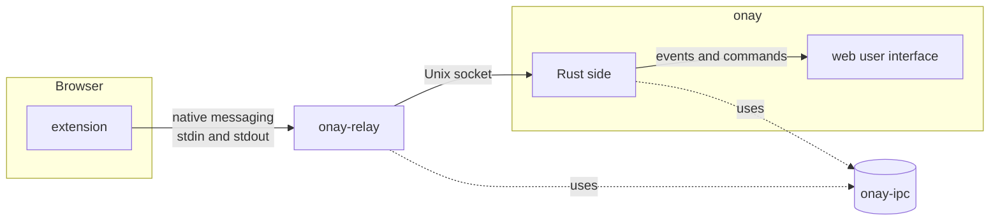

# The Onay app

A Tauri desktop app: a Rust program that shows a web page in its window. The Rust side owns the link to the browser extension, the keys, and later the verification. The web page in the window shows the result. The app never holds wallet keys and never answers a signing request. The wallet decides.

## Build and test

```
pnpm tauri dev         # build the relay, start the page with hot reload, open the window
pnpm build             # type-check and build the page only
pnpm test              # type-check and run the tests of the page's pure modules
pnpm bundle            # the package with the relay inside, in target/release/bundle/
cargo build            # both binaries
cargo test             # all Rust tests
cargo clippy --all-targets -- -D warnings
cargo fmt --all --check
cargo deny check       # advisories, licenses, sources, bans
```

The Rust tests cover the channel against the shared vectors, the key store, the peer rules, the whole link with a fake extension over a socket pair, and the relay binary against a fake app. The page tests in `test/` cover the pure gate modules: what a request names and what it runs, how a gate reports, the contract set and its verdicts, the Sourcify lookup, the compiler list and its hash check, the creation transaction, the state of the simulation on a fake chain, and the forms of a pasted request. Two tests run the real compiler: one with the real lib-sourcify on a small contract, one with the real EVM on three contracts that call each other. Both take the compiler build from `test/.cache/`, downloaded on the first run. The Clear Signing tests cover the trusted auditors, the plain decoding with the verified ABI, the data provider over a fake chain, the token lists, and the rendering with the real clear-signing library over a registry in memory.

The package settings live in `src-tauri/tauri.bundle.conf.json`, apart from the main Tauri config, so that `tauri dev` works without a packaged relay. `src-tauri/packaging/postinstall.sh` is the install script of the Linux packages.

## The parts

Three Rust crates in one Cargo workspace, and one web user interface.



| Path         | Builds                  | Does                                                                                                                                                                                                        |
| ------------ | ----------------------- | ----------------------------------------------------------------------------------------------------------------------------------------------------------------------------------------------------------- |
| `ipc/`       | a library               | What relay and app share: the host name, the extension ID, the socket path, and the framing of one native message. No dependencies.                                                                         |
| `relay/`     | the `onay-relay` binary | The bridge that Chrome starts. It copies bytes between the browser and the app's socket and does not read them. No dependencies except `ipc`.                                                               |
| `src-tauri/` | the `onay` binary       | The app. It registers the relay with the browsers, listens on the socket, checks who connects, runs the encrypted channel and the pairing, and keeps the state the window shows. Tauri gives it the window. |
| `src/`       | the page in the window  | React and Tailwind, same setup as the mock. It reads the state through Tauri commands and listens for one event that says "the state changed".                                                              |

The files inside `src/` and `src-tauri/src/` change with every step of the plan, so this document does not list them. The two lasting parts are the relay and the way a message gets into the app.

## From the extension to the window

Chrome can start a program for an extension, but it cannot connect to a program that already runs. This is the native messaging rule, and it is why the relay exists. One connection goes through these steps.

1. **The host manifest.** At start, the app writes a file for each installed browser, for example `~/.config/google-chrome/NativeMessagingHosts/dev.sourcify.onay.json`. The file names the path of the relay binary and the one extension ID that may use it. Brave on macOS reads the file in the directory of Chrome.
2. **Chrome starts the relay.** When the extension connects to the host `dev.sourcify.onay`, Chrome reads that file and starts the relay as a child process. Chrome talks to it over stdin and stdout. Each message is a 4-byte length followed by JSON.
3. **The relay connects to the app.** It opens the app's Unix socket at `$XDG_RUNTIME_DIR/onay/onay.sock` on Linux, or `$TMPDIR/onay/onay.sock` on macOS. Only the user can open that directory. From then on the relay copies bytes in both directions. It does not parse, buffer, or change them. When either side closes, it exits, and Chrome sees the port close. If the app is not running, the relay sends one message, `{"type":"error","message":"app not running"}`, and exits. The extension shows that and tries again later.
4. **The app checks the peer.** The app asks the kernel who connected. The peer must be our relay, run by the same user, and the relay's parent must be an approved browser: Chrome, Brave, Edge, or Vivaldi, Chromium on Linux, Arc on macOS, and the other channels of Chrome and Edge. On Linux that browser must be installed by a package manager: the binary and its directories belong to root. On macOS the running browser must have a valid code signature with an approved bundle identifier and Team ID, for example `com.google.Chrome` from Google's team `EQHXZ8M8AV`. Chromium has only an ad hoc signature, which any program can make, so the app refuses it on macOS. On Linux, the file `/etc/onay/custom_allowed_browsers` adds binary names, one for each line, if it belongs to root. A peer that fails gets one error message, and the window lists the reason.
5. **Hello.** Both sides send one message in the clear: their long-term X25519 public key and a random salt. Both derive the session keys with HKDF-SHA-256, two AES-256-GCM keys, one for each direction. The specification and the test vectors are shared with the extension, see `src-tauri/src/channel.rs` and `../testdata/`.
6. **Pairing.** If the app does not know the extension's key, both sides show a six-digit code computed from the two public keys. The user compares the codes and approves in the window. The app stores the key next to its own in the app data directory, for example `~/.local/share/dev.sourcify.onay/link.json` on Linux, and tells the extension. Delete that file to reset all pairings. A rejection closes the connection and stores nothing.
7. **Sealed messages.** Every later message is encrypted with a counter as nonce. A lost, repeated, reordered, or changed message fails to open, and the connection ends. The extension sends three kinds: a signing request that a page made, with the origin that the browser reported, the outcome the wallet gave, and a request to bring the window to the front. The app sends two kinds: paired, and pairing rejected.
8. **State and window.** The app keeps the connections, the pairing requests, and the last 50 signing requests in memory. After each change it emits one event to the page. The page then calls a command that returns the whole state and renders it. Three more commands answer a pairing, add a request that the user pasted, and dismiss a request.

## Clear Signing

The page renders each request with `@ethereum-sourcify/clear-signing`, Sourcify's ERC-7730 library, in `src/clear-signing/`. The library gets a descriptor from the registry on GitHub and the values it needs from the page. The page keeps the trust decisions: a descriptor from the registry counts as reviewed only when an auditor from the user's list attested it, and otherwise renders as a preview with a warning, and the library reads the revocation state of the attestation on Ethereum mainnet through the same chain command as the gates, so Helios checks it with a proof. Token names and decimals, NFT collection names, block times, and ENS names come from the chain the same way; an ENS name counts only when its forward record points back to the address. A contract that one of the user's token lists holds renders with the bundled ERC-20 template, with its own name and symbol read from the chain. The lists, in `src/clear-signing/tokenLists.ts`, follow the Uniswap Token Lists format and are fetched over HTTPS from the webview, at most once a day, with a size cap; the last good copy of each stays in use when a fetch fails, and a major version bump waits for the user. The app starts with the Uniswap Labs Default list. A list is a claim of its publisher, so the page marks what comes from it with the third-party icon. With or without a descriptor, an ABI-Decoded tab shows the calldata as the verified ABI decodes it, through ethers, which lib-sourcify brings in already. A call to a proxy decodes with the ABI of the contract whose code ran in its context in the simulation, the implementation of a proxy, the facet of a diamond or a library: the decoder tries the ABI of the callee first, then those contracts, and says which one matched. The Sourcify lookup asks for the proxy detection of the server too. It is a claim, not a finding: when it names that contract, the page says that Sourcify confirms the proxy; otherwise the page says that the contract may be a facet or a library.

Links to the registry and to the signature database open in the browser of the desktop through the `open_url` command in `src-tauri/src/browser.rs`. The webview has no window for a link. The command allows a few sites only and runs `xdg-open` on Linux, `open` on macOS, and `start` on Windows.

For this, `chain_request` answers `eth_call` and `eth_getBlockByNumber` too. Helios runs a call in its own EVM and fetches a proof for each account and slot that the call reads.

The relay ships inside the app package, next to the `onay` binary, so the user installs only app and extension. During development both binaries are in `target/debug/`. The Linux package makes the relay setgid to its own group, so the user cannot trace it or preload code into it.

## Pasted requests

A request can also come from the user, not from a page: pasted as text. `src/paste.ts` turns each form into the method and params of a request from a page, and the `add_request` command puts it in the same list, with the source `paste` and no connection. From there it goes through the same checks.

- A raw transaction in hex, signed or not. ethers decodes it, and the sender of a signed one comes from its signature. Blob transactions and EIP-7702 transactions are refused, because the simulation does not model them.
- JSON: a transaction with its `chainId`, or a JSON-RPC request with a signing method. Calldata alone goes in as a transaction: `{"chainId": 1, "to": "0x…", "data": "0x…"}`.
- EIP-712 typed data goes in as a JSON-RPC request, with the signing account in `params[0]`. Clear Signing needs that account, and typed data alone does not name it, so the card refuses typed data without an account and shows the form to use.

## The simulation

Next to the gates of the contracts that the request names, the page runs the calls of a transaction in a local EVM, the one of ethereumjs, for one purpose: the call tree. Every contract whose code runs on the way joins the list of contracts, and the Sourcify gate checks each one. The EVM reads accounts, code and storage slots as it needs them, through `chain_request` in Helios mode, where each read comes with a Merkle proof against the state root of the block, or straight from the endpoint in RPC mode. `src/gates/state.ts` is that state: it reads each value once, apart from a value first read inside a call that reverted, which the cache drops with the call, at the block that the request is checked at, and keeps the writes of the EVM with the checkpoints that a reverted call undoes. An endpoint in RPC mode must serve `eth_getProof`, which some public endpoints refuse or rate limit. `src/gates/simulation.ts` runs the calls and records each message as a frame of the tree: call, staticcall, delegatecall or create, the address whose code ran, the selector, the value, and the error if the message failed. A revert is a result, not a failure of the gate: the review shows the reason. The gate fails when the chain cannot be read.

A contract that the request names must pass both gates. A contract whose code runs as a named contract, the implementation of a proxy or a facet of a diamond, must pass too: the simulation records the context of each frame, and a delegatecall keeps the context of its caller. A contract that only the simulation found may have nothing on Sourcify: the request still passes, with the status `flagged`, and the review marks that contract. A contract on the way whose sources do not match the chain fails the request, like a named one. A transaction that reverts in the simulation ends the request with the status `reverts`: it does nothing on chain, so the review says not to sign it. A transaction whose call tree was not checked, because the simulation was skipped (a contract creation, a batch without a sender) or failed (a timeout, an endpoint that did not answer), leaves the request `flagged`, and the named contracts keep their own verdicts. A signature runs nothing on chain and is not flagged for it. `runVerdict` in `src/gates/contracts.ts` is where these rules live. An account with a delegate under EIP-7702 skips the Sourcify gate, since the code of the delegate is what runs, in the context of the account: the delegate of a named account counts as named, also when the simulation did not run, and the delegate of an account on the way is one more contract on the way.

What the simulation is not: a prediction of the gas, the fees or the effects. The EVM runs the calls alone, not in a block, with the rules of the newest Ethereum hardfork on every chain, the header of the block the request is checked at, and no block hashes. The calls of a batch (`wallet_sendCalls`) run one after the other from the sender of the batch, which is how a plain account would run them, not how a smart account does. An account under EIP-7702 runs the code of its delegate, and the delegate joins the list too.

## The Solidity compiler

The Sourcify gate compiles the sources in the page, with the official emscripten build of solc for the version Sourcify names. The build comes from `binaries.soliditylang.org`, and runs only if its SHA-256 is the one in the official list, which the page fetches fresh at each session. After the check the page keeps the build in the Cache API of the webview, so the next start does not download it again, and hashes it again each time it comes out of the cache. The cache is not trusted: a build that another process planted there fails the check and is thrown out.

web-solc runs the build in a worker made from a Blob, and the worker loads the build with `importScripts` from a Blob too. The Content Security Policy in `src-tauri/tauri.conf.json` therefore allows `blob:` in `script-src` and `worker-src`, and `'wasm-unsafe-eval'` because the build is WebAssembly. This widens the policy: any script in the page that can make a Blob can run it as code, and any script can instantiate WebAssembly. It is acceptable because the only scripts in the page are the bundle itself and the compiler builds, and a build reaches a Blob only after its hash matched the list. `connect-src` allows any HTTPS host and local ports, because the RPC endpoint of a chain is the user's choice. Tauri applies the policy to the packaged app only, not to `tauri dev`, so a change to it must be checked with the bundle.

In development the page runs on `localhost`. The packaged app serves the page from Tauri's own scheme, and WebKitGTK offers the Cache API there too: the Linux bundle keeps the builds in `~/.local/share/dev.sourcify.onay/CacheStorage/`, checked on 2026-10-13. The code handles a missing cache all the same, by downloading the build at each start.
